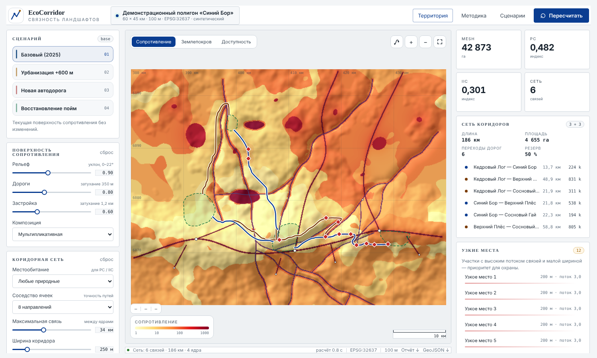
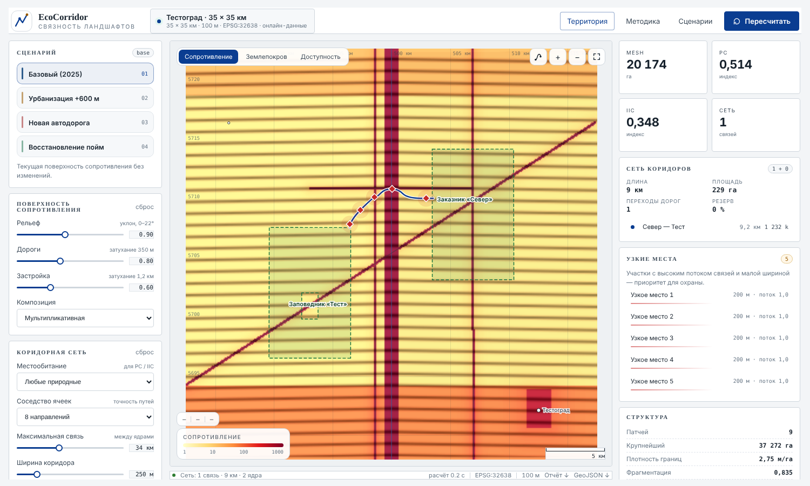

# EcoCorridor

Веб-приложение для анализа связности природных территорий: поверхность сопротивления, пути наименьшей стоимости, сеть экологических коридоров, индексы фрагментации (MESH, PC, IIC, ECA, dPC) и сравнение сценариев (урбанизация, новая дорога, восстановление пойм). Работает на демонстрационном синтетическом полигоне и на **любой территории, загружаемой онлайн**.



## Быстрый старт

```bash
git clone https://github.com/DmitryLeLeE/eco_corridor && cd eco_corridor
pip install -e .                       # для тестов: pip install -e ".[dev]"
ecocorridor                            # или: python -m ecocorridor --port 8000
# откройте http://127.0.0.1:8000
python -m pytest -q                    # 86 тестов
```

**Windows без установки Python.** На странице [Releases](https://github.com/DmitryLeLeE/eco_corridor/releases) лежит архив `ecocorridor-<версия>-windows-x64.zip`: распакуйте и запустите `ecocorridor.exe`. Откроется окно консоли (его нельзя закрывать, пока вы работаете) и браузер с приложением. Онлайн-загрузка территорий идёт через интернет, кэш хранится в `%USERPROFILE%\.cache\ecocorridor`. Приложение не подписано цифровой подписью, поэтому Windows SmartScreen может показать предупреждение («Подробнее» → «Выполнить в любом случае»).

Проверка загрузки на реальных сервисах (нужен интернет): `python scripts/smoke_online.py`.

Docker: `docker build -t ecocorridor . && docker run -p 8000:8000 -v ecocorridor-data:/data ecocorridor`.

Документация: <https://dmitrylelee.github.io/eco_corridor/> · Лицензия кода: MIT · Как цитировать: `CITATION.cff` · [CHANGELOG](CHANGELOG.md) · [Как внести вклад](CONTRIBUTING.md).

## Загрузка любой территории

Кнопка **«Территория»**: название (поиск Nominatim) или координаты центра → сторона кадра и разрешение → «Загрузить и рассчитать». Сервер скачивает данные один раз и кэширует их в `data/cache/` клона репозитория или в `~/.cache/ecocorridor` при установке пакета (переменная `ECOCORRIDOR_CACHE`).

| Данные | Источник |
|---|---|
| Землепокров, 10 м | ESA WorldCover 2021 v200 (облачные GeoTIFF на AWS, читаются фрагментами) |
| Рельеф | Copernicus DEM GLO-30, при отсутствии тайла — GLO-90, иначе плоская поверхность с предупреждением |
| Дороги, реки, населённые пункты, охраняемые территории | OpenStreetMap через Overpass API |

Особенности:

* Проекция UTM подбирается автоматически; кадр ограничен 15 000 км² и ~700 000 ячеек (иначе разрешение огрубляется, а слишком большой кадр обрезается до центрального квадрата — с предупреждением в интерфейсе).
* **Ядра** — охраняемые территории из OSM (`boundary=protected_area`, классы IUCN Ia–IV, `leisure=nature_reserve`), дубликаты и мелкие участки отбрасываются. Если их меньше двух, берутся крупнейшие лесные массивы; об этом приложение предупреждает.
* Дороги «впекаются» в землепокров отдельным классом; мосты пересекают воду, тоннели игнорируются.
* Загрузка идёт фоновой задачей с индикатором выполнения; одновременно — одна загрузка (бережём публичные сервисы).
* Адреса сервисов переопределяются переменными `ECOCORRIDOR_NOMINATIM`, `ECOCORRIDOR_OVERPASS` (список через запятую), `ECOCORRIDOR_WORLDCOVER_URL`, `ECOCORRIDOR_COPDEM30_URL`, `ECOCORRIDOR_COPDEM90_URL` (шаблоны с `{tile}`) — так тесты работают на локальных синтетических тайлах.
* Серверу нужен доступ к `nominatim.openstreetmap.org`, `overpass-api.de`, `esa-worldcover.s3.eu-central-1.amazonaws.com`, `copernicus-dem-30m.s3.amazonaws.com`.



API: `GET /api/territory/search?q=`, `POST /api/territory/plan`, `POST /api/territory/load` → `GET /api/territory/jobs/{id}`, `GET /api/projects`; расчётные эндпоинты (`/api/analyze`, `/api/compare`, …) принимают `project_id`.

## Методика кратко

1. **Поверхность сопротивления** — базовая стоимость класса землепокрова × поправки за уклон, дороги и застройку.
2. **Путь наименьшей стоимости** — Дейкстра на растровом графе (8 или 16 соседей); стоимость ребра — длина шага × среднее сопротивление пересекаемых ячеек.
3. **Сеть коридоров** — минимальное остовное дерево по стоимости связей плюс альтернативные пути в допуске к остову.
4. **Индексы** — MESH (Jaeger 2000), IIC (Pascual-Hortal & Saura 2006), PC и ECA (Saura & Pascual-Hortal 2007), dPC (Pascual-Hortal & Saura 2006; Saura & Pascual-Hortal 2007); все нормированы на площадь **всего ландшафта**.

## Проверка на научность — главное

Подробный разбор: **[docs/METHODOLOGY_REVIEW.md](docs/METHODOLOGY_REVIEW.md)**. Коротко:

**Найдено и исправлено** (каждое — с тестом, который падает на старом коде):

* индексы нормировались на площадь местообитаний вместо площади ландшафта (MESH демо: 60 070 → 42 873 га);
* PC учитывал только прямые пары патчей, без цепочек (stepping stones);
* IIC использовал расстояния PC и обрезал число переходов; расстояния считались по прореженным точкам границы;
* диагональные рёбра костпата «протекали» между барьерами (стоимость прохода сквозь барьер 141 → 70 781);
* направленное смещение 8-соседства (удлинение до 1,082) — добавлен режим 16 соседей (1,027);
* сценарии были привязаны к координатам демо и к зашитому набору «естественных» классов;
* в тексте методики стояла ссылка на статью о заполнении понижений рельефа (Barnes 2014), не относящуюся к модели, а McRae (2008) цитировалась как реализованный метод.

**Остаётся ограничением** (подробно — в документе):

* PC, IIC и MESH считаются по прямым расстояниям и **не реагируют на изменение одного лишь сопротивления** (сценарий «Восстановление пойм» даёт ΔPC = 0); для проницаемости есть **PC и ECA по стоимости** (эффективное расстояние = стоимость пути / опорное сопротивление, по умолчанию 10, не откалибровано; до 400 крупнейших патчей);
* least-cost path — один оптимальный путь, не теория цепей; «узкие места» — эвристика, а не pinch points Linkage Mapper;
* сопротивления классов экспертные и не откалиброваны; результат чувствителен к ним: при разбросе ×exp(N(0; 0,5)) положение коридоров совпало с базовым лишь на ~0,45 (IoU), остов — на 0,97 (`python scripts/sensitivity.py`);
* точность WorldCover около 77 %, OSM неполон в малонаселённых районах.

**Что не проверялось:** реальные скачивания с серверов ESA/Copernicus/OSM в среде разработки были закрыты — загрузчик проверен на синтетических тайлах и подложном Overpass; с Conefor 2.6 сверены PC, IIC и ECA на игрушечном примере и на демо (разница ≤ 5·10⁻⁷; `scripts/conefor_check.py`), с Graphab и на реальной территории сравнения не было.

## Структура

```
src/ecocorridor/
  online.py        загрузка территорий (геокодер, тайлы, Overpass, кэш)
  costpath.py      растровый граф и Дейкстра
  resistance.py    поверхность сопротивления
  corridors.py     сеть коридоров, потоки, узкие места
  fragmentation.py MESH / PC / IIC / ECA / dPC
  scenarios.py     сценарии
  analysis.py      оркестрация и кэш результатов
  api.py           FastAPI
  static/          интерфейс (Canvas, без картографических библиотек)
  demo_data/       синтетический демо-полигон «Синий Бор»
scripts/           make_demo_data.py, sensitivity.py, rref_sweep.py, conefor_check.py, calibrate.py, smoke_online.py, build_pages.py
tests/             аналитические тесты и тесты загрузчика
docs/              справка, методика, валидация, аудит (сайт Pages)
```

## Лицензии данных

© участники OpenStreetMap (ODbL); ESA WorldCover — CC BY 4.0 (Zanaga et al. 2022); Copernicus DEM — © ESA / Copernicus. Код распространяется под лицензией MIT (файл `LICENSE`).
