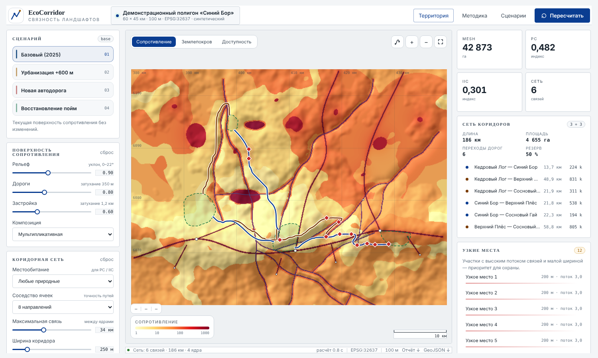

# EcoCorridor

Открытый инструмент для оценки связности природных территорий: от поверхности сопротивления и путей наименьшей стоимости до сети экологических коридоров, индексов фрагментации (MESH, PC, IIC, ECA, dPC) и сравнения сценариев. Работает на демонстрационном полигоне и на любой территории, данные которой подгружаются онлайн.

<a class="cta primary" href="demo/index.html">Открыть демо (предрассчитанные результаты)</a>
<a class="cta" href="guide.html">Справка</a>
<a class="cta" href="methodology.html">Методика</a>
<a class="cta" href="https://github.com/DmitryLeLeE/eco_corridor">Код на GitHub</a>

## Что делает программа

1. Строит **поверхность сопротивления** перемещению из землепокрова, уклона, расстояния до дорог и застройки.
2. Находит **пути наименьшей стоимости** между ядрами (охраняемыми территориями) и собирает из них **сеть коридоров**: опорный остов и альтернативные связи.
3. Считает **индексы структуры и связности ландшафта**: MESH, деление, индекс крупнейшего патча, плотность границ, PC, IIC, ECA, вклад патчей dPC.
4. Сравнивает **сценарии**: базовый, рост застройки, новая автодорога, восстановление пойм.
5. Для **любой территории** скачивает землепокров (ESA WorldCover 10 м), рельеф (Copernicus DEM) и векторные данные OpenStreetMap, подбирает проекцию UTM и кэширует результат.

## Как читать результаты и чему можно верить

> **Статус методики: сценарный инструмент, не прогноз.** Сопротивления классов землепокрова экспертные и не откалиброваны по данным о перемещениях животных. Индексы PC, IIC и MESH считаются по геометрии патчей и **не реагируют на изменение одного лишь сопротивления**. Результат пригоден для сравнения сценариев на одной территории и для выявления мест, требующих полевой проверки, но не для абсолютных заключений о проницаемости или о судьбе популяций. Полный список ограничений — в [аудите методики](review.html) и в разделе [«Научные принципы»](science.html).

## Состояние проверки (версия {{VERSION}})

| Что | Статус |
|---|---|
| Алгоритмы путей и индексов сверены с аналитическими примерами | выполнено, 85 автоматических тестов, включая сверку с независимой эталонной реализацией ([Валидация](validation.html)) |
| Чувствительность к неоткалиброванным сопротивлениям | оценена на демо (20 прогонов Монте-Карло) |
| Численное сравнение индексов с Conefor / Graphab | подготовлено, не выполнено: экспорт в формат Conefor и скрипт сравнения готовы ([Валидация](validation.html), раздел 6) |
| Загрузка реальных данных ESA / Copernicus / OSM | проверена на синтетических тайлах и подложном Overpass; на реальных серверах требует проверки пользователем |
| PC и ECA на cost-weighted расстояниях | реализованы; зависят от неоткалиброванного опорного сопротивления Rref ([Валидация](validation.html), раздел 3) |
| Калибровка и валидация по данным о перемещениях | код калибровки готов и проверен на симуляции; на реальных данных не проводилась (нужны точки или треки пользователя) |

## Разделы сайта

* [Справка](guide.html) — установка, интерфейс, параметры, загрузка территорий, экспорт, API, типичные проблемы.
* [Методика](methodology.html) — полное описание: формулы, значения по умолчанию, допущения.
* [Валидация](validation.html) — что и как проверено, результаты анализа чувствительности.
* [Данные](data.html) — источники, версии, лицензии, точность.
* [Воспроизводимость](reproducibility.html) — окружение, детерминизм, как повторить расчёт.
* [Научные принципы](science.html) — соответствие принципам FAIR4RS, раскрытие использования ИИ, ответственность, цитирование.
* [Аудит методики](review.html) — найденные ошибки, исправления, ограничения.
* [Источники](references.html), [История изменений](changelog.html).
